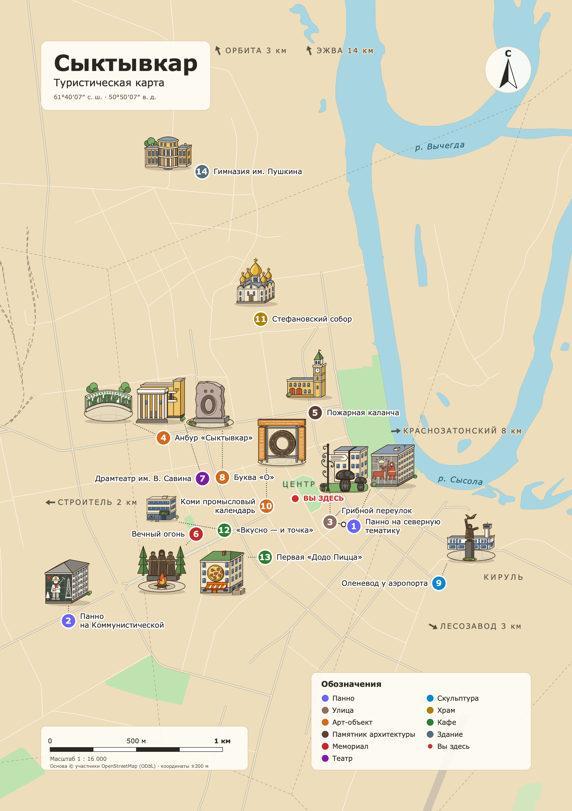
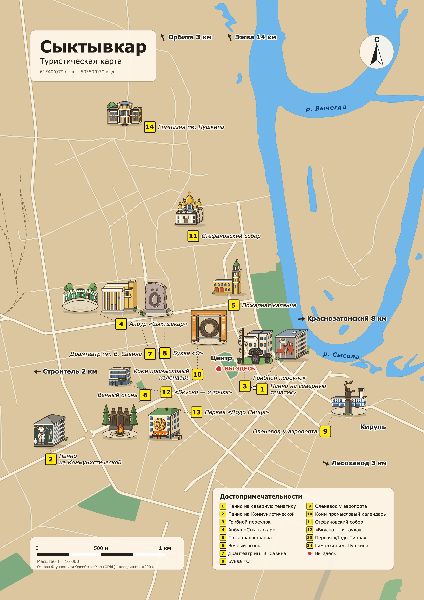
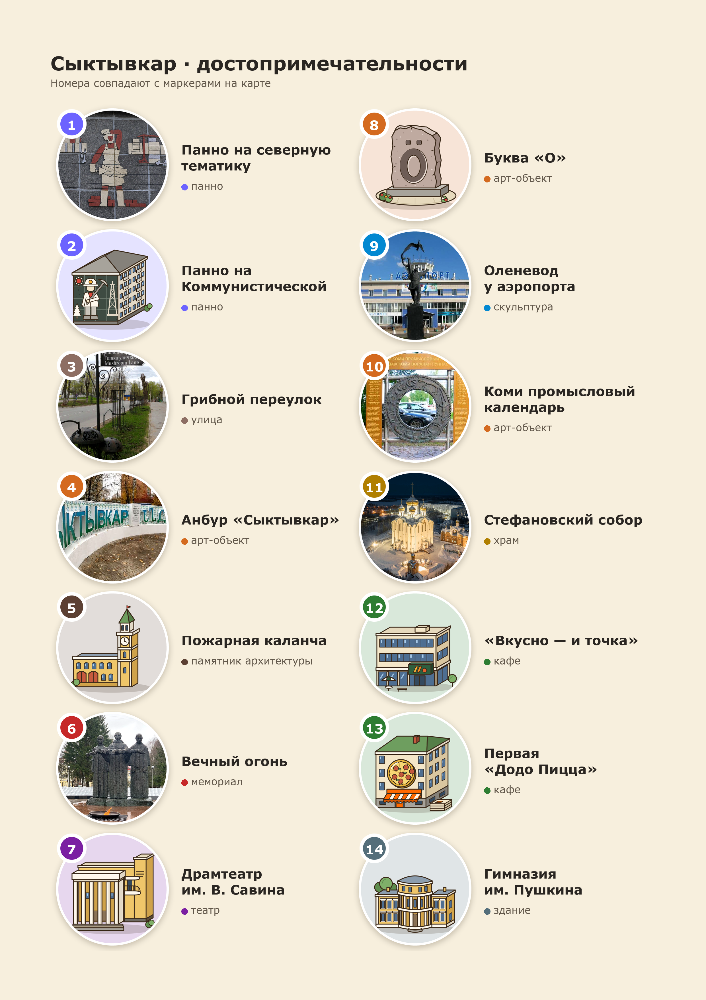
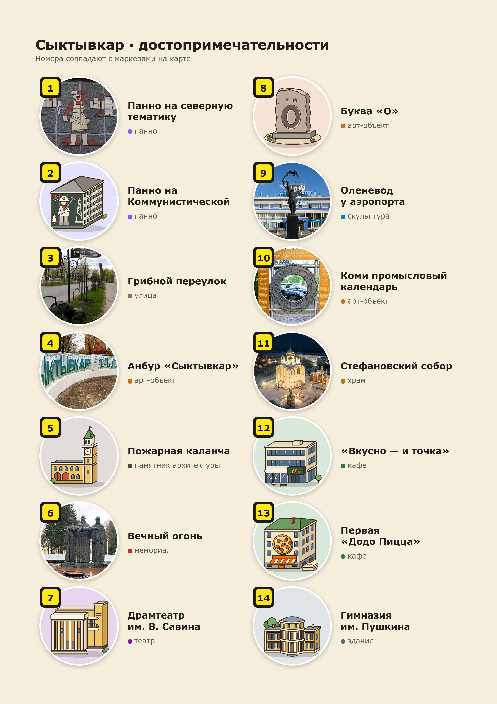

# Туристическая карта Сыктывкара

Один скрипт собирает из `attractions.json` все артефакты сразу в двух стилях.

**Стили:**
- **tz** — строго по ТЗ: пастель, номера в цветных кругах по категориям, легенда категорий, подписи районов капсом. Файлы называются, как в ТЗ.
- **ref** — как на карте-референсе: песочная суша, широкие кремовые улицы с окантовкой, насыщенные зелень и вода, жёлтые квадратные номера, курсивные подписи. Вместо легенды категорий — нумерованный список точек. К файлам добавляется суффикс `_ref`.

| Файл (tz / ref) | Для чего |
|---|---|
| `syktyvkar_map.svg` / `syktyvkar_map_ref.svg` | вектор A4 (2480×3508, 300 DPI) для печати и правки. Группы верхнего уровня открываются в Inkscape как слои: `land`, `parks`, `rivers`, `streets`, `districts`, `you-are-here`, `markers`, `labels`, `title`, `north`, `scalebar`, `legend`, `index`, `guides` (скрытая рамка safe zone) |
| `syktyvkar_map.png` / `syktyvkar_map_ref.png` | растр 2480×3508, RGB, белый фон, 300 DPI — для вёрстки буклета |
| `attractions_legend.png` / `attractions_legend_ref.png` | лист A4: сетка 2×7 круглых фото, номера того же вида, что на карте |
| `index_tz.html` / `index.html` | автономная интерактивная карта для QR-кода: SVG, фото, CSS и JS внутри одного файла; опубликованный стиль `ref` остаётся в `index.html` |
| `syktyvkar_map.pdf` / `syktyvkar_map_ref.pdf` | векторный PDF карты — на него ведёт кнопка «Скачать PDF» |

Подложка (реки, парки, улицы) — данные OpenStreetMap, закешированные в `geo/syktyvkar_osm.json`. Обычный запуск работает без сети.

Исходники:

| Файл | Что это |
|---|---|
| `generate_map.py` | генератор: один запуск — все файлы обоих стилей |
| `attractions.json` | единственный источник данных: 14 точек с описаниями и адресами |
| `photos/` | фото точек (есть для 7 из 14) |
| `illustrations/` | 14 мультяшных рисунков объектов (SVG) и гайд по их стилю |
| `geo/syktyvkar_osm.json` | кеш подложки OpenStreetMap |
| `requirements.txt` | зависимости Python |

## Превью

| По ТЗ (`tz`) | Как на референсе (`ref`) |
|---|---|
|  |  |
|  |  |

GitHub не открывает интерактивную карту прямо из репозитория, есть два способа её посмотреть:
- скачать `index.html` и открыть в браузере;
- включить GitHub Pages (Settings → Pages → ветка `main`, папка `/`). Тогда карта будет по адресу `https://karimovdev.github.io/syktyvkar-map/`, а вариант «как на референсе» — по `…/index_ref.html`.

## Установка

Нужны Python 3.10+ и системная библиотека cairo (для PNG и PDF).

```bash
brew install cairo
```

```bash
uv venv .venv && uv pip install --python .venv/bin/python -r requirements.txt
```

Без `uv`: `python3 -m venv .venv && .venv/bin/pip install -r requirements.txt`.

Шрифт карты — DejaVu Sans. Если его нет в системе, PNG и PDF рисуются Verdana (скрипт предупредит), а в SVG остаётся исходный стек шрифтов. Чтобы PNG был именно в DejaVu:

```bash
brew install --cask font-dejavu
```

## Запуск

```bash
.venv/bin/python generate_map.py
```

В конце скрипт печатает самопроверку: число точек в JSON, на карте, в легенде и в HTML; сдвинутые подписи; контраст подписей; размеры файлов. Для точек без фото он выдаёт WARN и рисует заглушку с инициалами.

Другие режимы:

```bash
.venv/bin/python generate_map.py --style ref
```

Собирает только один стиль: `tz` или `ref`. По умолчанию — оба.

```bash
.venv/bin/python generate_map.py --refresh-geo
```

Перекачивает подложку из OpenStreetMap (Overpass API), это 1–3 минуты.

```bash
.venv/bin/python generate_map.py --cmyk ISOcoated_v2_eci.icc
```

Дополнительно сохраняет `syktyvkar_map_cmyk.tif` и `syktyvkar_map_ref_cmyk.tif` (см. «Печать»).

## Как добавить точку

Только в `attractions.json`: остальное перегенерируется.

```json
{
  "id": 15,
  "name": "Национальный музей",
  "category": "музей",
  "address": "ул. Коммунистическая, 2",
  "description": "Одна-две фразы для карточки в HTML.",
  "photo": "15-museum.jpg",
  "lat": 61.6712,
  "lon": 50.8401
}
```

- `id` — номер на маркере, в легенде и в HTML.
- `photo` — файл в `photos/`. Если поле пустое, скрипт ищет `photos/15-*.jpg`, а если не нашёл — рисует заглушку.
- `lat` / `lon` — координаты. Без них точка встанет у центра с предупреждением `TODO: verify`.
- Новой категории нужен цвет в `PALETTE`. Без него маркер будет серым, скрипт предупредит.
- Если подпись не помещается на карте, она уходит в столбец «Указатель» справа.

## Как поменять палитру

- Цвета категорий — константа `PALETTE` в начале `generate_map.py`.
- Цвета подложки — константы рядом: `LAND`, `WATER`, `PARK`, `STREET_MAJOR` и т. д. Это стиль `tz`.
- Стиль `ref` — словарь `STYLES["ref"]` ниже: в нём только то, что отличается от `tz` (цвета, толщины улиц, форма и цвет маркеров, курсив, вид легенды, имена файлов). Новый стиль — ещё один ключ в `STYLES`.
- Если цвет категории слишком светлый для белого номера, номер автоматически станет тёмным.
- Контраст проверяется в самопроверке.

## Рисунки объектов, как на референсе

У каждой точки есть мультяшный рисунок в `illustrations/` — 14 векторных SVG в едином стиле. На обеих картах:
- рисунок встаёт прямо над своим номером;
- если над номером занято подписями, он уходит в ближайшее свободное место, а к номеру ведёт пунктирная выноска.

В HTML клик по рисунку выбирает объект и открывает кнопки размера миниатюры. Если у точки нет фото, в легенде и HTML-карточке вместо заглушки с инициалами показывается рисунок.

### Навигация и выноски в HTML

При увеличении карты миниатюры плавно подходят ближе к своим номерам, если там достаточно места. Размещение учитывает соседние рисунки, маркеры и подписи; на общем виде сохраняется исходная композиция. Цвета, шрифты, рисунки и печатные файлы не меняются.

Названия улиц появляются от масштаба 1,7×, второстепенные — от 2,4×. Номера домов из адресов достопримечательностей появляются от 4×, если подпись помещается без наложений. Подписи улиц следуют существующей геометрии; номера привязаны к контурам зданий в локальном кеше OpenStreetMap. В кеше есть точные адреса для 10 домов из списка; отсутствующие номера не добавляются по приблизительным координатам точек.

На экранах шириной до 860 px выбор точки открывает компактную карточку снизу. «Подробнее» раскрывает описание, «Свернуть» возвращает компактный вид, × или Escape закрывает карточку. Карта остаётся доступной для перемещения и увеличения. Выноски учитывают закрытую карточкой область.

При выборе положения рисунка учитываются пересечения его линии с другими выносками. Если прямой путь занят, линия пробует обойти рисунок, подпись или другую линию с одним-двумя изгибами. В очень тесном месте выбирается вариант с наименьшим числом пересечений. Выбранные рисунок и линия выделяются. В семи HTML-карточках без фотографии встроен исходный SVG-рисунок: растеризатор и загрузка внешних ресурсов не нужны.

- Перетаскивание рисунка меняет только положение миниатюры. Выноска сохраняет связь с номером и доходит до края рисунка. Ручное положение действует до сброса или перезагрузки страницы.
- Нажатие на рисунок открывает кнопки **− / + / ↺**. Размер ограничен диапазоном 60–180%; толщина выноски не зависит от размера рисунка. Также работает **Shift + колесо** над рисунком.
- **↺**, двойной щелчок по рисунку или **0 / Home** возвращают автоматическое размещение и размер. **⤢** возвращает всю карту и сбрасывает все рисунки.
- При фокусе на миниатюре **стрелки** перемещают её, **Shift + стрелки** увеличивают шаг, **+ / −** меняют размер. При выборе карточки в кадр попадают точка и связанный рисунок.
- На сенсорном экране рисунок можно двигать одним пальцем; два пальца на нём меняют его размер. Жест двумя пальцами на карте учитывает и масштаб, и перенос центра жеста.

Логика хранится в `map_navigation.js`, дополнительные стили управления — в `map_navigation.css`. `generate_map.py` встраивает их в HTML. Для обновления только интерактивного поведения без пересборки географии, иллюстраций и печатных файлов:

```sh
python web_navigation.py
```

Проверки геометрии и автономной HTML-сборки:

```sh
node --test qa/navigation_geometry.test.cjs
python qa/verify_web_navigation.py
```

- Заменить или добавить рисунок — см. [illustrations/README.md](illustrations/README.md): там описан стиль, чтобы новые рисунки не выбивались. Подойдёт и PNG с прозрачным фоном от иллюстратора.
- Отключить рисунки на карте — `SHOW_ILLUSTRATIONS = False` (можно для одного стиля в `STYLES`).
- Размер на карте — `ILLU_SIZE` (190 px ≈ 16 мм в печати).
- Рисунки — стилизация по фото. Для №8 (буква «Ӧ»), №12 («Вкусно — и точка») и №13 («Додо») фото найти не удалось, они нарисованы по описаниям; сверьте с натурой.

## Публикация index.html и QR-код

1. Пропишите адрес будущей страницы в `SITE_URL` в `generate_map.py`, например `"https://example.ru/syktyvkar/"`, и перезапустите скрипт. Без этого соцсети не покажут превью: og:image должен быть абсолютной ссылкой.
2. Залейте на любой статический хостинг (GitHub Pages, Netlify Drop, Яндекс Object Storage, хостинг сайта) три файла выбранного стиля рядом:
   - `index.html` (стиль `ref`) или `index_tz.html` (стиль `tz`, при публикации отдельно переименуйте в `index.html`);
   - `syktyvkar_map.pdf` / `syktyvkar_map_ref.pdf` (или `syktyvkar_booklet.pdf`, если положите готовый буклет — кнопка сама переключится на него);
   - `syktyvkar_map.png` / `syktyvkar_map_ref.png` (картинка для превью).
3. QR-код делайте на этот URL. Лучше короткий адрес без лишних параметров: чем короче ссылка, тем крупнее модули кода. Параметры:
   - коррекция ошибок Q (25%);
   - сторона кода в буклете не меньше 20–25 мм;
   - белое поле вокруг — 4 модуля;
   - тёмный код на светлом фоне, без инверсии.

   Векторный QR для вёрстки:

   ```bash
   uvx --from qrcode qr --factory=svg-path --error-correction=Q "https://example.ru/syktyvkar/" > qr.svg
   ```

4. Перед тиражом отсканируйте пробный оттиск двумя-тремя телефонами.

## Печать

- Все файлы — RGB (sRGB). Типографии обычно нужен CMYK: уточните у неё профиль; для мелованной бумаги это чаще всего ISO Coated v2 (FOGRA39).
- Растровый CMYK делает сам скрипт:

  ```bash
  .venv/bin/python generate_map.py --cmyk ISOcoated_v2_eci.icc
  ```

  Внутри это `PIL.ImageCms`: перевод sRGB → профиль с relative colorimetric. Профиль `ISOcoated_v2_eci.icc` бесплатно скачивается на eci.org (раздел Downloads, архив ECI Offset 2009).
- Векторный PDF лучше переводить в CMYK в Acrobat, Illustrator или у самой типографии. Тогда мелкий чёрный текст останется 100% K, а не четырёхкрасочным.
- Вылеты: подложка в SVG уходит на 10 мм за обрез, а `viewBox` — это формат после обреза. Если типографии нужен файл с вылетами, экспортируйте из Inkscape с полем 10 мм: Документ → Размер → поля.
- Всё важное лежит внутри safe zone 15 мм. Её рамка — скрытый слой `guides`.

## Что поставлено для проекта и как удалить

Системно ничего не устанавливалось: ни Homebrew-пакетов, ни шрифтов, ни глобальных pip-пакетов. Python не скачивался — `uv` взял уже установленный у вас CPython 3.12.13 (`~/.local/share/uv/python/cpython-3.12.13-macos-aarch64-none`, с марта 2026).

| Что | Где | Как удалить |
|---|---|---|
| Виртуальное окружение (cairosvg 2.9.1, cairocffi, cffi, pycparser, cssselect2, tinycss2, defusedxml, webencodings, pillow 13.0.0), ≈14 МБ | `.venv/` в проекте | `rm -rf .venv` |
| Скачанные пакеты в общем кеше `uv` | `~/.cache/uv` (общий для всех проектов) | `uv cache clean cairosvg cairocffi pillow cffi pycparser cssselect2 tinycss2 defusedxml webencodings svgwrite` или `uv cache prune` |
| Конфиг для превью в браузере Claude (локальный `http.server` на порту 8765) | `.claude/launch.json` | `rm -rf .claude` |
| Копии подобранных фото (оригиналы в `Достоприечательности/` не тронуты) | `photos/` | удалять не нужно — это входные данные |
| Кеш подложки OSM | `geo/syktyvkar_osm.json` | удалите, чтобы скачать заново |

Уже стояло до проекта и использовалось как есть: Homebrew-библиотека `cairo` (`/opt/homebrew/lib`), шрифт Verdana из macOS, утилита `uv`.

## Отличия от ТЗ и что проверить

- **География по OpenStreetMap расходится с ТЗ:**
  - №14 (гимназия, ул. Петрозаводская, 4) — в ~1,9 км к северу от центра, а не на северо-востоке;
  - №9 (скульптура «Юноша с птицей» у аэровокзала) — в ~0,9 км к востоку от Стефановской площади;
  - районы Эжва, Краснозатонский, Орбита, Лесозавод, Строитель оказались за краем листа и подписаны у края стрелкой с расстоянием.
- **Стефановский собор (№11)** стоит на ул. Свободы, 60: фото — нынешнего собора. Историческое место — Стефановская площадь, там же «Вы здесь».
- **Буква «О» (№8)** — памятник коми букве «Ӧ».
- **Границы районов схематичные** (диаграмма Вороного по центрам районов): реальных полигонов этих районов в OSM нет.
- **Стиль `ref` намеренно отступает от ТЗ** ради сходства с референсом: магистрали 14 px вместо 6, второстепенные 6 px вместо 2, маркеры жёлтые квадратные вместо цветных кругов, нет пунктирных границ районов. В `tz` всё по ТЗ.
- **Цвета двух категорий в `tz` затемнены:** «арт-объект» `#F4A259` → `#D46A1F`, «храм» `#FBC02D` → `#B07F00` — белый номер на исходных цветах не читался.
- **Нет фото у 7 точек:** №2, 5, 7, 8, 12, 13, 14 — в легенде и HTML вместо фото стоят рисунки. Свободные по лицензии снимки нашлись на Wikimedia Commons для №5, 7, 14; их можно добавить с указанием авторства.
- **Неиспользованные фото:** в `Достоприечательности/` есть снимки объектов, которых нет в списке (Мемориал покаяния, дом под шпилем, панно на Октябрьском, 34, Сорокин, сундук, торговый дом Дербеневых) — на карту не попали.
- **Координаты приблизительные** (±50–200 м), источники — в комментариях к `APPROX_COORDS`.
- **Лицензия OSM:** карта содержит данные OpenStreetMap; подпись «© участники OpenStreetMap (ODbL)» обязательна и уже стоит на карте и в HTML.
